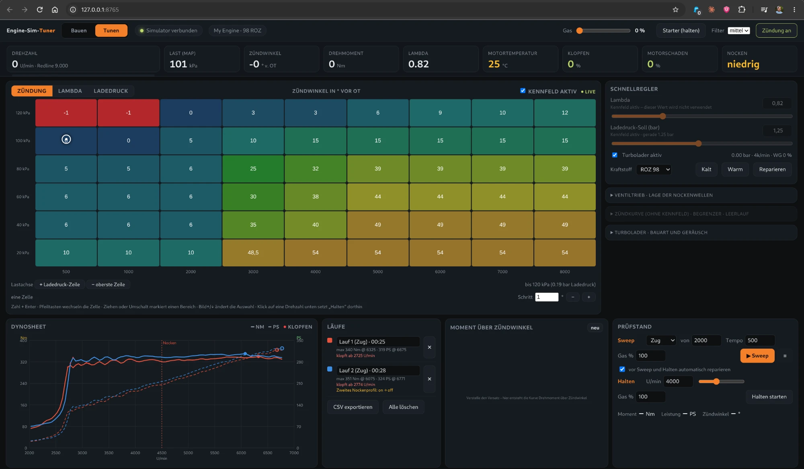

# Engine Sim Tuner



> **Note:** The user interface is currently **German only**. The code, comments and this README are in English.

A tuning and comparison tool built on [ange-yaghi/engine-sim](https://github.com/ange-yaghi/engine-sim). It shows what a change (camshaft, ignition, mixture, boost ...) does to the way an engine runs, with realism as a nice-to-have.

**What is new compared to the original**

- **Tuning cockpit in the browser** (`web/`): live gauges, an editable ignition / lambda / boost-target table, quick controls, and a fixed dyno dock (sweep and speed hold, run comparison, CSV export). An engine builder generates the engine script (layouts, presets, compression, cams, VTEC-like second profile) and loads it without restarting.
- **Headless server** `engine-sim-server`: simulation, sound (SDL2) and HTTP interface without a window. Runs on Linux and Windows. The original windowed `engine-sim-app` stays Windows-only.
- **Models**: knock (Livengood-Wu) with fuels from Super 95 to E85, lambda per air mass, wall temperature / warm-up, camshaft centreline (VVT-like), exhaust-gas turbocharger with wastegate, blow-off valve and turbo sound.

The simulation is not calibrated against real engines. Use it to compare variants, not for engineering numbers.

## Quick start

Linux and Windows build instructions are in the sections below. Start `engine-sim-server` from the `build` directory (asset paths are relative to it). It opens the interface in your browser; without an engine it starts in the builder. Command line: `--port N`, `--no-open`, `--keep-alive`.

On Windows, a CI build publishes a ready-to-run zip (see the Actions tab and the Releases page).

### Building on Windows

1. Visual Studio with the C++ workload (includes CMake, Ninja and `vswhere`).
2. vcpkg: `vcpkg install sdl2 sdl2-image boost-filesystem --triplet x64-windows-static-md`, and set `VCPKG_ROOT` to the vcpkg folder.
3. `winget install WinFlexBison.win_flex_bison` (open a new console afterwards).
4. `git clone --recurse-submodules <this repository>`
5. Run `tools\windows-build\build.bat` (builds `engine-sim-server` and `engine-sim-app` into `build\`).

The submodules `delta-studio`, `piranha` and `simple-2d-constraint-solver` point to forks (`tuner` branch) that contain the build fixes and the Linux port, so no patching is needed.

---

### Linux

On Linux the simulator runs as the headless server `engine-sim-server`. It provides the simulation, the sound (SDL2 audio) and the web interface in the browser. The windowed application `engine-sim-app` is Windows only.

1. Clone with submodules: `git clone --recurse-submodules https://github.com/tierlord/engine-sim-tuner`
2. Install the build dependencies (Debian/Ubuntu): `sudo apt install cmake libsdl2-dev libsdl2-image-dev libboost-filesystem-dev flex bison libgl-dev`
3. Configure and build:

```bash
cmake -S . -B build -DCMAKE_BUILD_TYPE=Release
```

```bash
cmake --build build --target engine-sim-server
```

4. Start the server from the `build` directory, because the asset paths are relative to it: `cd build && ./engine-sim-server`. It opens the interface in the default browser. Use `--no-open` to skip that.

Discord Rich Presence is disabled on Linux, the bundled `discord-rpc` library only exists for Windows.

## Credits and license

This project is a fork of [engine-sim](https://github.com/ange-yaghi/engine-sim) by Ange Yaghi (AngeTheGreat). The original simulator, its sound library and the underlying physics are his work; see the [Engine Simulator Community Edition](https://github.com/Engine-Simulator/engine-sim-community-edition) for the actively developed game. Released under the MIT license (see `LICENSE`).
